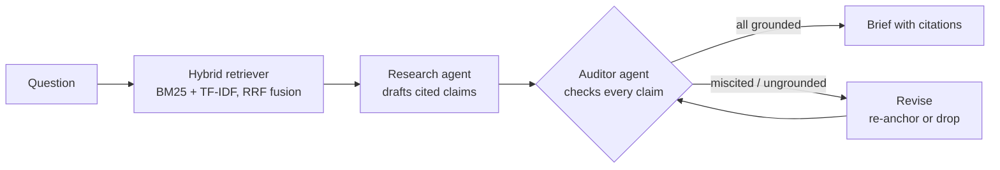

# Agentic RAG Evaluation Harness

[](https://github.com/dawncreter/agentic-rag-evaluation-harness/actions/workflows/ci.yml)

A research agent drafts cited answers from a document library. An independent **auditor agent** checks every claim against the source text, then drops invented claims and repairs wrong citations before anything reaches a reader. A built-in **A/B benchmark** measures the difference.

> **Reference implementation.** This repo uses a fictional company's policy documents and runs fully offline. It shows the pattern behind the GenAI proposal platform I led at Growth Signals (see the [case study](https://github.com/dawncreter/genai-proposal-platform-case-study)). It is not that client's code or data.

## Why it matters
Proposal, policy and compliance teams can't use an AI draft they can't trust. The fastest way to cut review time is to make every sentence traceable to an approved source, and to catch the ones that aren't **before** a human reviewer sees them.

## How it works


| Component | File | What it does |
|---|---|---|
| Chunker | `chunker.py` | Heading-aware chunks with sentence overlap, so citations point to a real section |
| Hybrid retriever | `retriever.py` | Okapi BM25 + TF-IDF cosine, fused with Reciprocal Rank Fusion |
| Model clients | `llm.py` | Offline extractive model, a **NoisyLLM** that injects hallucinations and wrong citations, and an optional Claude client |
| Auditor + graph | `agents.py` | Research → Audit → Revise loop with a conditional edge (LangGraph-compatible node functions) |
| Benchmark | `evaluation.py` | Fact recall, grounding rate, hallucination rate and latency across pipelines |

### Auditor scoring
For claim *c* and passage *p*:

`support(c, p) = |tokens(c) ∩ tokens(p)| / |tokens(c)|`, and it is set to **0** if any number in *c* (amounts, %, days) is missing from *p*.

* **grounded**: the cited passage supports the claim (support ≥ 0.6)
* **miscited**: another retrieved passage supports it, so the citation is re-anchored
* **ungrounded**: nothing supports it, so the claim is removed

## Results (included benchmark, 10 gold questions)
```text
$ rag-harness bench
| Pipeline                    | Fact recall | Grounding rate | Hallucination rate |
|-----------------------------|-------------|----------------|--------------------|
| A: noisy model, no auditor  | 90%         | 23%            | 27%                |
| B: noisy model + auditor    | 90%         | 100%           | 0%                 |
| C: baseline model + auditor | 90%         | 100%           | 0%                 |
```
The auditor removes every injected hallucination and fixes every wrong citation **without losing correct answers**.

## Quick start
```bash
pip install -e ".[dev]"
rag-harness ask "How long are contract records retained?"
rag-harness bench
make test        # 15 tests, ~97% branch coverage
```
To draft with Claude instead of the offline model: `pip install -e ".[claude]"` and set `ANTHROPIC_API_KEY`. The auditor and the benchmark stay the same, so you can A/B test models.

## Results from the real-world version (Growth Signals)
~80% faster first drafts, and review cycles cut from **8 hours to 15 minutes**, validated through A/B testing.

## License
MIT
